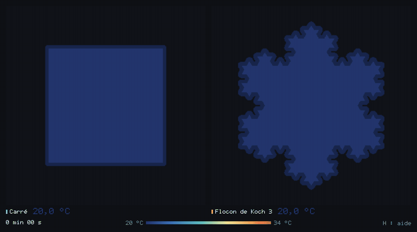
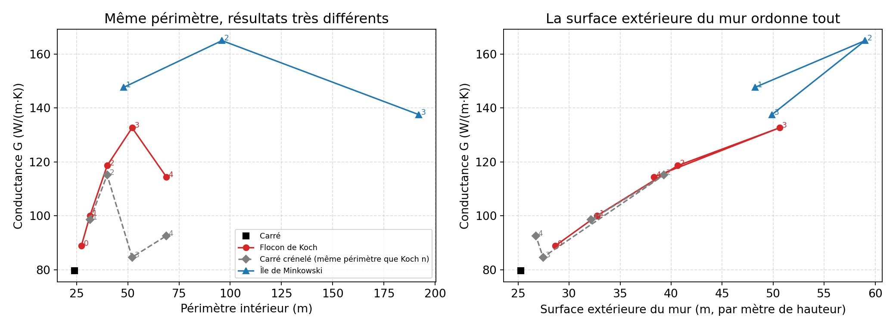

# Heat diffusion and fractal geometries

*[Version française](README.md) (full documentation) · [Report (PDF, French)](docs/rapport/rapport.pdf)*

**For the same floor area, does a fractal-shaped room get rid of heat better than a
square one?** A C simulation of the heat equation (finite volumes, implicit
alternating-direction scheme, conjugate gradient), checked against an exact
solution, with an SDL window that shows the diffusion live.



*Same area (36 m²), same 2 kW heat source, 20 cm concrete walls: after one week the
square room sits at 30 °C, the Koch snowflake at 26 °C. Thin lines are isotherms
(every 1 °C).*

Personal research project by Devrim Genc. It started as a model written during
*classes préparatoires* (French intensive maths/physics programme) and was rebuilt
from the ground up: physical units, validated schemes, grid convergence, parametric
study.

## Key results

- **The fractal gets rid of heat better, up to a point.** A depth-3 Koch snowflake
  loses **66 %** more heat per degree of temperature difference than the square. At
  depth 4 the gain falls back to 44 %: the details (9 cm) are thinner than the wall
  (20 cm), which fills them in.
- **Optimal-depth law.** A level of detail helps as long as the wall is thinner
  than that detail: depth n stops paying off beyond a wall thickness
  **e_c ≈ 0.86 ℓ_n** (ℓ_n: detail size at depth n; measured at 36 m²). This gives a
  simple rule for the optimal depth: n_opt = ⌊log₃(0.86 s / e)⌋.
- **Wall length is not what matters.** A crenellated square with the same perimeter
  as the snowflake matches it while its notches are wide, then collapses all at once
  (+6 % instead of +66 %). The fractal degrades gradually: its advantage comes from
  having **detail at several scales**. Across all shapes and wall thicknesses, the
  heat loss tracks the *outer* wall surface (log correlation 0.82), not the inner
  perimeter (0.46).
- **Main limitation.** Surface heat exchange is assumed to be the same everywhere.
  In narrow notches, convection and radiation are actually weaker, which would
  reduce the gain (see [Limitations](#limitations-and-next-steps)).



## Build and run

```bash
brew install sdl2 pkg-config      # macOS (Linux: libsdl2-dev pkg-config)
make                              # builds ./thermalfractalsim
make run                          # interactive window
make test                         # validation: circular room vs exact solution (≈ 1 min)
make regime                       # accurate steady state, square + Koch 0 to 4 (≈ 1 min)
make figures                      # report and README figures (Python: numpy, pandas, matplotlib)
make gif                          # README animation (≈ 1 min, needs ffmpeg)
make rapport                      # LaTeX report
```

Window keys: `Space` pause, `+`/`−` speed, `0`–`4` snowflake depth, `F`
temperature ↔ heat-flux view, `I` isotherms, `S` record CSV, `H` help, `Q` quit.

## Model

A horizontal cross-section of a room, in physical units, per metre of height.

- **Air** stirred by convection, modelled as an effective conductivity
  (λ_air = 100 W/(m·K), so heat spreads through the room in about 2 minutes).
- **Walls**: concrete (λ = 1.75 W/(m·K)), 20 cm by default; surface resistances
  from ISO 6946. Outside held at 20 °C; 800 W/m source at the room's centroid.
- **Finite volumes**, conservative by construction: the energy balance closes to
  machine precision.
- **Time stepping**: Douglas-Rachford alternating-direction implicit scheme. Each
  row and column is a tridiagonal system solved in O(n) with the **Thomas
  algorithm**. Unconditionally stable; an explicit scheme would need Δt ≈ 0.004 s.
- **Steady state** solved directly by diagonally preconditioned **conjugate
  gradient** (about 10 s on a 1200 × 1200 grid, instead of 5 to 12 simulated days).
- **Grid-bias corrections**: staircase surfaces on slanted walls and rounded wall
  thickness are both corrected face by face from the true contour.

## Validation

- **Exact solution.** A circular room (radial conduction, closed-form profile) run
  through the unmodified simulation code at three resolutions: error on G of
  −1.5 %, −0.85 %, −0.45 % (first-order convergence). Without the surface
  corrections, the error is stuck at +14 % at every resolution, a bias that would
  have favoured the fractal.
- **Grid convergence** on the real shapes: G changes by 0.03 % (Koch 0) to 1 %
  (Koch 4) between 1.25 cm and 0.625 cm cells.
- Each test exposed a real defect in the original model (diffusivity used in place
  of conductivity, `float` precision stalling the solver, one-pixel walls 15 % too
  conductive). The history is in the French README.

## Limitations and next steps

1. **Uniform surface exchange** (main limitation): narrow notches get less
   convection, and facing walls radiate to each other rather than outwards. Next
   step: radiation view factors and notch-dependent convection.
2. **Effective air conductivity** is an order of magnitude only; a sensitivity
   study is still to do.
3. **One floor area**: the optimal-depth law is measured at 36 m²; other areas would
   tell whether e_c/ℓ is universal.
4. **Fixed outside temperature**: a day/night cycle with sun and self-shading is the
   natural step for the climate question (in a heatwave, more wall means more heat
   coming in).
5. **3D**: with diffusion only, an extruded room reduces to the 2D model; 3D only
   becomes useful with natural convection or a volumetric fractal.

## Layout

```
src/        C code: geometry (Koch, crenellated square, Minkowski), physics (finite volumes,
            ADI + Thomas, conjugate gradient), rendering, SDL window, command line
tests/      validation against the exact circular-room solution
scripts/    Python analysis: time series, depth study, optimal-depth sweep and law
results/v4/ current model results (time series, steady state, optimal-depth sweep)
docs/       LaTeX report and its figures, window captures and animation
```
