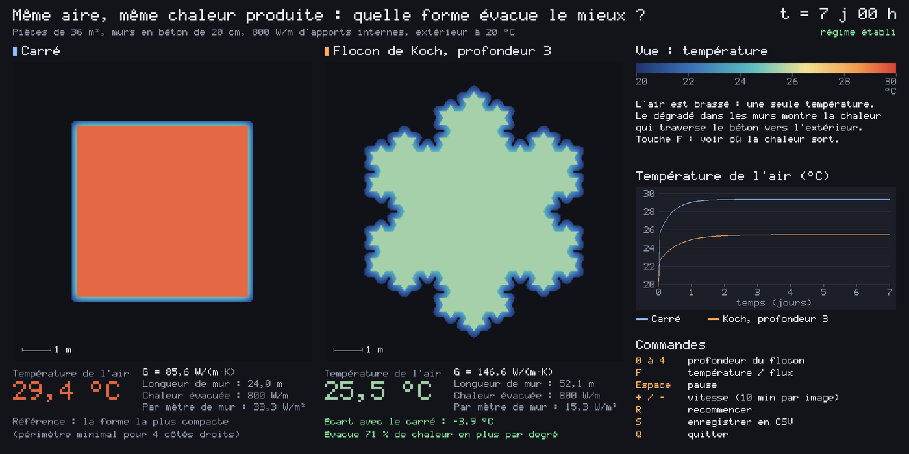
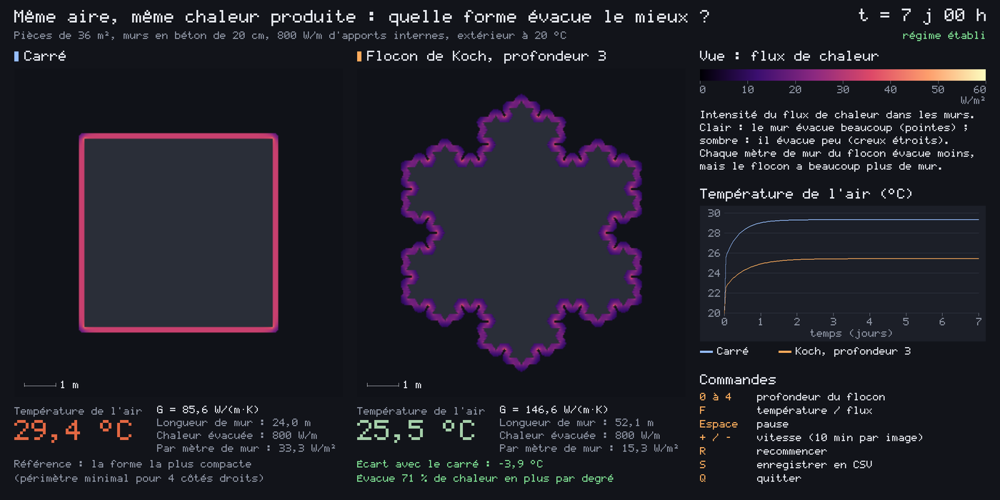

# Diffusion thermique et géométries fractales

Projet de recherche personnel de Devrim Genc. Ce dépôt reprend la simulation
de l'ancien dépôt GitLab (`tests/diffusion`).

## Problématique

> Dans un monde qui se réchauffe, à aire égale, de combien une géométrie fractale
> augmente-t-elle la chaleur évacuée passivement, et à quelles conditions ?

Une enveloppe d'habitation a intérêt à être compacte : plus de surface, c'est plus de
pertes en hiver et plus d'apports en canicule. La fractale est donc étudiée comme
**échangeur** (façade, mur, dissipateur) chargé d'évacuer de la chaleur produite à
l'intérieur vers un milieu plus froid (air nocturne, sol).

On compare une pièce dont le contour est un **flocon de Koch** à une **pièce carrée
de même aire** (36 m²). La pièce reçoit des apports internes (occupants,
équipements) et les évacue à travers des murs en béton vers l'extérieur, à 20 °C.
La grandeur étudiée est la **conductance de l'enveloppe**
G = P / (T_air − T_ext) : la puissance évacuée par degré d'écart entre l'air
intérieur et l'extérieur.

Mots-clés : fractales, suites, récursivité, programmation en C, équation de la
chaleur, volumes finis, complexité.

## Compilation et exécution

```bash
brew install sdl2 pkg-config      # macOS
make                              # compile ./thermalfractalsim
make run                          # fenêtre interactive (grille de 3,5 cm)
make data                         # carré + Koch 0 à 4 sans fenêtre, grille de 1,25 cm (≈ 2 min)
make plot                         # courbes temporelles + étude en profondeur
make test                         # validation : pièce circulaire comparée à la solution exacte (≈ 10 s)
```

Images de la fenêtre sans l'ouvrir (pour le README, un rapport, une présentation) :

```bash
./thermalfractalsim --capture image.bmp 3 temp 168   # profondeur 3, vue température, après 168 h
./thermalfractalsim --capture image.bmp 4 flux 240   # profondeur 4, vue flux, après 10 jours
```

Mode sans fenêtre : la simulation tourne jusqu'au régime établi (une ligne de
CSV par heure simulée) :

```bash
./thermalfractalsim --headless carre                # → res_carre.csv
./thermalfractalsim --headless koch3                # flocon de profondeur 3 → res_koch3.csv
./thermalfractalsim --headless koch2 20000 f.csv    # nombre d'itérations et fichier imposés
```

Géométries : `carre`, `koch0` (triangle) à `koch4`, et `fractal` (= `koch2`).
Le résumé final affiche la température de l'air, le **bilan d'énergie**
(en régime établi, `P_ext = Q_int`) et la conductance G.

### Fenêtre interactive

Le carré (référence) et un flocon de Koch, de même aire et avec les mêmes apports de
chaleur, sont simulés côte à côte. Sous chaque pièce : la température de l'air, la
conductance G, la longueur de mur, la chaleur évacuée et le flux moyen par mètre de
mur ; pour le flocon, l'écart de température et le gain par rapport au carré. À
droite : la légende des couleurs, la courbe de la température de l'air des deux
pièces et les commandes. Pendant la montée en température, G est marquée
« provisoire » : P / (T_air − T_ext) n'est la conductance de la pièce qu'en régime
établi.



Vue **température** : l'air brassé a une seule température ; le dégradé dans les
murs montre la chaleur qui traverse le béton. Après 7 jours, le flocon de
profondeur 3 reste à 25,5 °C, contre 29,4 °C pour le carré.



Vue **flux de chaleur** (touche F) : intensité du flux dans les murs, en W/m².
Chaque mètre de mur du flocon évacue moins que celui du carré (15 W/m² contre 33 en
moyenne), surtout au fond des creux, mais le flocon a deux fois plus de mur.

| Touche | Action |
|---|---|
| 0 à 4 | Profondeur du flocon (les deux pièces repartent de zéro) |
| F | Vue température ↔ flux de chaleur |
| Espace | Pause |
| + / − | Vitesse (de 2,5 min à 2 h 40 simulées par image) |
| R | Recommencer |
| S | Démarrer / arrêter l'enregistrement CSV des deux pièces (`res_carre.csv`, `res_koch<n>.csv`) |
| Q, Échap | Quitter |

Le texte est affiché avec une petite police bitmap intégrée (`src/font.c`) : aucune
bibliothèque en plus de SDL2 n'est nécessaire.

Format du CSV : une ligne de commentaire décrivant la géométrie
(`# geometrie=koch2 profondeur=2 aire_m2=... perimetre_m=... t_ext=...`, lue avec
`pandas.read_csv(..., comment="#")`), puis les colonnes
`Iter,Time_h,T_air,T_mur,P_int,P_mur,P_ext` :

- `Time_h` : temps simulé en heures ; `T_air` : température de l'air ;
  `T_mur` : température moyenne des murs (°C) ;
- `P_int` : apports internes ; `P_mur` : puissance de l'air vers les murs ;
  `P_ext` : puissance des murs vers l'extérieur (W par mètre de hauteur).

Chaque lancement écrase les CSV de la racine, que git ignore : il faut les
déplacer dans `results/<version>/` pour les garder.

## Organisation

```
src/
  thermal_diffusion.h   paramètres physiques et structure Sim
  geometry.c            contours (Koch récursif, carré) de même aire, murs épais, corrections de surface
  physics.c             volumes finis, conductances des faces, stabilité, statistiques, bilan
  io.c                  allocation, réinitialisation, enregistrement CSV
  render.c              cartes de couleurs (température, flux), flux de chaleur dans les murs
  ui.c                  fenêtre interactive (deux pièces côte à côte, légende, courbes), --capture
  font.c                police bitmap intégrée
  main.c                ligne de commande, mode headless
tests/test_anneau.c     validation sur une pièce circulaire (solution exacte), plusieurs résolutions
scripts/analyse.py      évolution temporelle de toutes les simulations d'un dossier
scripts/profondeur.py   régime établi en fonction de la profondeur de Koch
results/v0/             premiers résultats (ancien dépôt, régime non établi)
results/v1/             headless, stats sur l'air, schéma encore non conservatif
results/v2/             schéma conservatif en unités de grille (float)
results/v3/             modèle physique, carré + Koch 0 à 4, grille de 1,25 cm
docs/                   export GeoGebra ; captures/ : images de la fenêtre
```

## Modèle (v3)

Coupe horizontale d'une pièce, en unités physiques ; les grandeurs sont données
**par mètre de hauteur** (puissances en W/m, conductances en W/(m·K)).

| | Valeur |
|---|---|
| Pièce | 36 m² pour toutes les géométries (carré de 6 m) |
| Air intérieur | brassé par la convection : une seule température T_air, ρc = 1 206 J/(m³·K) |
| Murs | béton de 20 cm : λ = 1,75 W/(m·K), ρc = 2,3·10⁶ J/(m³·K) |
| Surfaces (ISO 6946) | R_si = 0,13 m²·K/W (intérieur), R_se = 0,04 m²·K/W (extérieur) |
| Apports internes | Q_int = 800 W/m, soit 2 kW pour 2,5 m de haut (≈ 55 W/m²) |
| Extérieur | thermostat à 20 °C |
| Grille | 300 × 300 cases de 3,5 cm (fenêtre) ; 1 200 × 1 200 cases de 1,25 cm (`make data`) |
| Pas de temps | 30 s, schéma explicite |

- **Géométrie.** Le contour intérieur est un polygone exact (flocon de Koch ou
  carré). Une case est de l'air si son centre est dans le polygone, du mur si elle
  est à moins de 20 cm du contour, côté extérieur. Le mur suit le contour vers
  l'extérieur : il comble les creux plus étroits que son épaisseur.
- **Volumes finis.** Chaque case de mur a une capacité ρc·Δx² ; chaque face, une
  conductance égale à l'inverse des résistances traversées (demi-cases de béton,
  résistance superficielle). Le flux d'une case vers sa voisine est l'opposé du flux
  inverse : l'énergie est conservée, et le bilan boucle à la précision machine.
- **Air brassé.** L'air est un seul nœud : c'est la méthode standard en thermique du
  bâtiment. Résoudre l'air sur la grille avec une conductivité « efficace » élevée
  imposerait un pas de temps d'environ 0,01 s, alors qu'il faut une semaine
  simulée pour que les murs atteignent le régime établi.
- **Corrections de surface.** Deux défauts de la grille sont corrigés, face par
  face, à partir du vrai contour (voir la validation) :
  - *escalier* : un mur incliné d'un angle θ est une suite de marches qui compte
    L·(|cos θ| + |sin θ|) de faces pour une longueur L. Les résistances de surface
    sont multipliées par ce facteur, calculé avec la vraie normale au contour ;
  - *épaisseur* : les cases sont entières, si bien qu'un mur de 20 cm sur des cases
    de 3,5 cm n'en faisait que 17,5 (G du carré trop grande de 5 %). Chaque face de
    surface reçoit la résistance de l'épaisseur manquante (ou en trop) entre la
    face et la vraie surface.
- **Stabilité.** Δt · Σ conductances ≤ capacité, pour chaque case de mur et pour le
  nœud d'air ; vérifié au démarrage (au plus 0,58 avec les valeurs ci-dessus).

## Résultats (v3)

`make data`, régime établi, grille de 1,25 cm (`results/v3/`) :

| | Périmètre intérieur | T_air | G (W/(m·K)) | G / G_carré | G par mètre de mur |
|---|---|---|---|---|---|
| Carré | 24,0 m | 29,37 °C | 85,4 | 1,00 | 3,56 |
| Koch 0 (triangle) | 27,4 m | 28,25 °C | 97,0 | 1,14 | 3,55 |
| Koch 1 | 31,6 m | 27,27 °C | 110,0 | 1,29 | 3,48 |
| Koch 2 | 40,0 m | 26,04 °C | 132,5 | 1,55 | 3,32 |
| Koch 3 | 52,1 m | 25,33 °C | **150,2** | **1,76** | 2,88 |
| Koch 4 | 68,9 m | 26,23 °C | 128,4 | 1,50 | 1,87 |

Repère : un mur droit de ce type transmet U = 1 / (R_si + e/λ + R_se) =
3,52 W/(m²·K), soit 3,52 W/(m·K) par mètre de mur et de hauteur.

**Lecture.**
- Avec les mêmes apports internes, le flocon de profondeur 3 reste à **25,3 °C**
  contre **29,4 °C** pour le carré : il évacue 76 % de chaleur en plus par degré
  d'écart.
- Le gain est inférieur à l'allongement du mur (+117 % de périmètre à la
  profondeur 3) : chaque mètre de mur sert de moins en moins (dernière colonne).
  Dans les creux, les murs voisins se partagent la chaleur, et la surface
  extérieure du mur est plus courte que la surface intérieure.
- **Il existe une profondeur optimale, ici 3.** À la profondeur 4, les détails
  (9 cm) sont plus petits que l'épaisseur du mur (20 cm) : le mur bouche les creux,
  sa surface extérieure raccourcit (faces extérieures : 5 100 → 3 916), et G
  diminue. L'épaisseur du mur limite physiquement la fractale.

**Convergence en maillage** (G en W/(m·K)) :

| | Δx = 5 cm | 3,5 cm (fenêtre) | 2,5 cm | 1,25 cm (`make data`) |
|---|---|---|---|---|
| Carré | 85,4 | 85,6 | 85,4 | 85,4 |
| Koch 0 | 96,5 | 96,6 | 96,7 | 97,0 |
| Koch 2 | 131,3 | 131,1 | 132,3 | 132,5 |
| Koch 3 | 144,1 | 146,6 | 146,4 | 150,2 |
| Koch 4 | 118,4 | 119,5 | 123,8 | 128,4 |

Jusqu'à la profondeur 2, les résultats sont stables à 1 % près. Aux profondeurs 3 et
4, ils ne sont pas encore convergés : les pointes à 60° et les creux étroits sont mal
résolus sur une grille grossière (à 5 cm, la surface intérieure de Koch 3 compte
4,7 % de faces de moins que la valeur théorique ; à 1,25 cm, 0,5 %). Leurs valeurs à
1,25 cm sont probablement un peu sous-estimées, mais l'ordre des résultats (maximum
à la profondeur 3) est le même à toutes les résolutions. La fenêtre (3,5 cm)
sous-estime G de Koch 3 d'environ 2 %.

## Validation : test de la pièce circulaire

`make test` simule une pièce circulaire de rayon Ra = 1,6 m (air à 30 °C imposé),
entourée d'un mur de béton jusqu'à Rb = 1,8 m, et compare la puissance à la solution
exacte (trois résistances en série) :

P = (T_air − T_ext) / ( R_si/(2π Ra) + ln(Rb/Ra)/(2π λ) + R_se/(2π Rb) )

Le code de la simulation est réutilisé tel quel, à trois résolutions
(Δx = 5 ; 2,5 ; 1,25 cm). Un cercle contient toutes les orientations de mur.
`R_surf` est la résistance des surfaces déduite de la simulation, rapportée à sa
valeur exacte (1 = surfaces correctement représentées).

| Cas | Erreur sur P à 5 cm | 2,5 cm | 1,25 cm | R_surf (1,25 cm) |
|---|---|---|---|---|
| Conduction seule, sans corrections | +3,5 % | +2,1 % | +0,7 % | — |
| Conduction seule, avec corrections | −0,6 % | −0,3 % | −0,2 % | — |
| Surfaces de la norme, sans corrections | +14,0 % | +14,2 % | +14,2 % | 0,795 |
| Surfaces de la norme, avec corrections (simulation) | −1,6 % | −0,9 % | −0,5 % | 1,008 |

**Lecture.**
- La conduction dans le mur converge quand la grille s'affine. La correction
  d'épaisseur divise l'erreur par 4 à 6 et rend la convergence régulière (l'erreur
  est divisée par 2 quand Δx est divisé par 2).
- Sans correction, la résistance des surfaces est trop faible de 20 % **à toutes les
  résolutions**. C'est exactement la valeur théorique : sur un cercle, la moyenne
  de 1/(|cos θ| + |sin θ|) vaut 0,794. Pour un flocon (murs à 0°, 60° et 120°), le
  biais aurait favorisé la fractale face au carré (dont les murs sont alignés sur la
  grille et ne subissent pas de biais) : G de Koch 0 passait de 97 à 109 W/(m·K).
- Avec les corrections, l'erreur est divisée par 2 à chaque raffinement et reste
  sous 1 % dès 2,5 cm.
- Le cercle moyenne les positions des murs par rapport à la grille : il ne voyait
  pas le défaut d'épaisseur, visible seulement sur des murs droits (carré). C'est la
  comparaison du carré à plusieurs résolutions qui l'a révélé.

## Historique des corrections

- v1 : mode `--headless` (régime établi), statistiques limitées à l'air intérieur.
- v2 : schéma conservatif. Un premier test de l'anneau y a mesuré deux défauts :
  les murs d'un pixel avaient une résistance trop faible de 15 % quelle que soit la
  résolution, et la précision `float` figeait le calcul avant le régime établi
  (bilan faux de 0,01 à 0,16 %). Températures passées en `double`.
- v3 : unités physiques ; diffusivité α et conductivité λ séparées (le code v2
  mettait α là où il faut λ, ce qui rendait le mur 10 fois moins conducteur que
  l'air, l'inverse de la réalité) ; air brassé au lieu d'air immobile ; murs épais ;
  résistances superficielles avec correction d'escalier ; pertes de Newton
  retirées (sol et plafond considérés comme adiabatiques).
- v3.1 : correction d'épaisseur des murs ; nouvelle fenêtre (deux pièces côte à
  côte, vue flux, légende, courbes, police intégrée), option `--capture`.

## Limites actuelles et pistes

1. **Résolution des petits détails** : aux profondeurs 3 et 4, G varie encore de 3 à
   4 % entre les grilles de 2,5 et 1,25 cm. Pistes : grille plus fine, ou un
   solveur direct du régime établi (∇·(λ∇T) = 0), beaucoup plus rapide que le
   schéma explicite.
2. **Extérieur à température fixe** : en canicule, l'extérieur est plus chaud que
   l'intérieur, et la fractale ferait entrer plus de chaleur. Étape naturelle : un
   cycle jour/nuit, où le bilan dépend de l'inertie des murs.
3. **Mur non isolé** : avec un isolant, la résistance du mur domine et le rôle de la
   forme change. Variante à tester (béton + 10 cm d'isolant).
4. **Contrôle** : comparer la fractale à une forme non fractale de même périmètre
   (carré crénelé), pour savoir si c'est la fractale qui compte ou seulement la
   longueur du mur.
5. **Modèle 2D** : sol et plafond adiabatiques, air parfaitement brassé ; le
   rayonnement entre parois est inclus de façon conventionnelle dans R_si et R_se.
