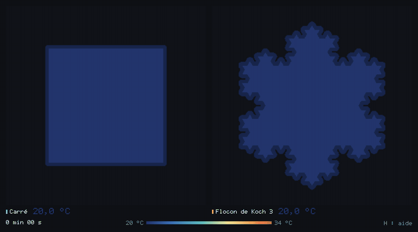
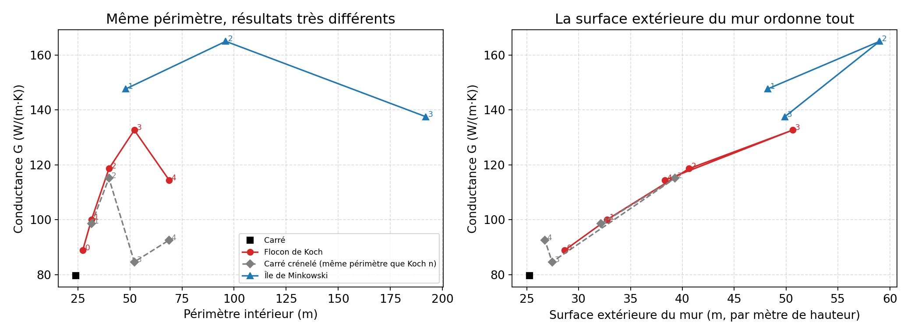
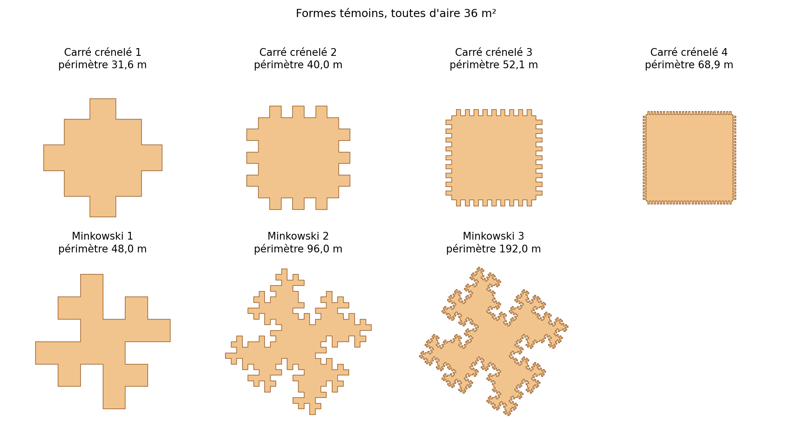
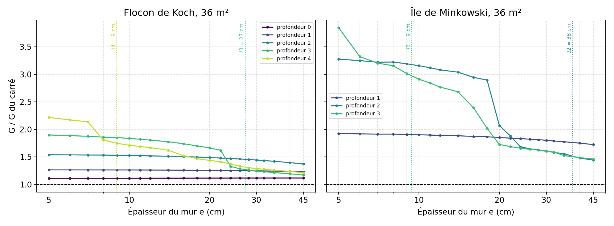
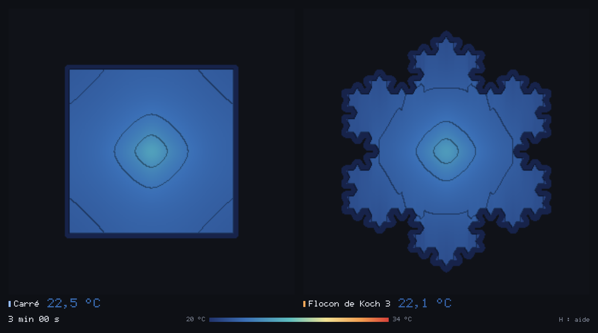
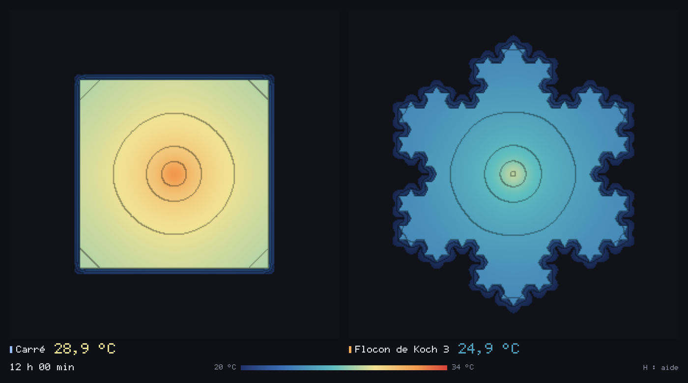

# Diffusion thermique et géométries fractales

*[English version](README.en.md)*

**À aire égale, une pièce en forme de fractale évacue-t-elle mieux la chaleur qu'une
pièce carrée ?** Simulation en C de l'équation de la chaleur (volumes finis, schéma
implicite, gradient conjugué), validée sur une solution exacte, avec une fenêtre SDL
qui montre la diffusion en direct.



*Même aire (36 m²), même source de 2 kW, murs en béton de 20 cm : après une semaine,
le carré est à 30 °C, le flocon de Koch à 26 °C. Les traits fins sont les isothermes
(une tous les 1 °C).*

Projet de recherche personnel de Devrim Genc, issu d'un modèle écrit en classe
préparatoire et repris de fond en comble : unités physiques, schémas validés,
convergence en maillage, étude paramétrique.

## En bref

- **La fractale évacue mieux, jusqu'à un certain point.** Le flocon de Koch de
  profondeur 3 évacue **66 %** de chaleur en plus par degré d'écart que le carré. À la
  profondeur 4, le gain retombe à 44 % : les détails (9 cm) sont plus fins que le mur
  (20 cm), qui les bouche.
- **Loi de l'optimum.** Un niveau de détail sert tant que le mur est plus fin que
  lui : la profondeur n cesse d'être utile au-delà d'une épaisseur
  **e_c ≈ 0,86 ℓ_n** (ℓ_n : taille des détails du niveau n ; établi à 36 m²). D'où une règle simple
  pour la profondeur optimale : n_opt = ⌊log₃(0,86 s / e)⌋.
- **Ce n'est pas la longueur du mur qui compte.** Un carré crénelé de même périmètre
  que le flocon fait aussi bien tant que ses créneaux sont larges, puis s'effondre
  d'un coup (+6 % au lieu de +66 %). La fractale, elle, se dégrade progressivement :
  son avantage vient de ses **détails à plusieurs échelles**.
- **Limite principale.** Les échanges de surface sont supposés identiques partout ;
  dans les creux étroits, la convection et le rayonnement sont plus faibles en
  réalité, ce qui réduirait le gain (voir [Limites](#limites-et-pistes)).



Le détail du modèle, des mathématiques et des méthodes numériques est dans le
[rapport (PDF)](docs/rapport/rapport.pdf).

## Problématique

> Dans un monde qui se réchauffe, à aire égale, de combien une géométrie fractale
> augmente-t-elle la chaleur évacuée passivement, et à quelles conditions ?

Une enveloppe d'habitation a intérêt à être compacte : plus de surface, c'est plus de
pertes en hiver et plus d'apports en canicule. La fractale est donc étudiée comme
**échangeur** (façade, mur, dissipateur) chargé d'évacuer de la chaleur produite à
l'intérieur vers un milieu plus froid (air nocturne, sol).

On compare des pièces dont le contour est un **flocon de Koch** (profondeur 0 à 4) à
une **pièce carrée de même aire** (36 m²). Une source de chaleur placée au centre
chauffe l'air, qui transmet la chaleur aux murs en béton, puis à l'extérieur, à
20 °C. La grandeur étudiée est la **conductance de l'enveloppe**
G = P / (T_air − T_ext) : la puissance évacuée par degré d'écart entre l'air
intérieur (température moyenne) et l'extérieur.

Mots-clés : fractales, récursivité, C, équation de la chaleur, volumes finis, schéma
implicite (Douglas-Rachford), algorithme de Thomas, gradient conjugué, validation,
convergence en maillage.

## Compilation et exécution

```bash
brew install sdl2 pkg-config      # macOS (Linux : libsdl2-dev pkg-config)
make                              # compile ./thermalfractalsim
make run                          # fenêtre interactive
make test                         # validation : pièce circulaire comparée à la solution exacte (≈ 1 min)
make regime                       # régime établi précis, carré + Koch 0 à 4 (≈ 1 min)
make loi                          # loi de l'optimum : épaisseurs, formes témoins (résultats déjà fournis)
make figures                      # figures du rapport et du README
make gif                          # animation du README (≈ 1 min, ffmpeg)
make data                         # courbes dans le temps (≈ 2 min)
make rapport                      # rapport LaTeX
```

Python : `numpy`, `pandas`, `matplotlib`.

## Résultats

### Régime établi, mur de 20 cm

`make regime`, régime établi, grille de 1,25 cm (`results/v4/regime/`) :

| | Périmètre intérieur | T_air moyenne | G (W/(m·K)) | G / G_carré | G par mètre de mur |
|---|---|---|---|---|---|
| Carré | 24,0 m | 30,04 °C | 79,7 | 1,00 | 3,32 |
| Koch 0 (triangle) | 27,4 m | 29,01 °C | 88,8 | 1,11 | 3,25 |
| Koch 1 | 31,6 m | 28,00 °C | 100,0 | 1,26 | 3,17 |
| Koch 2 | 40,0 m | 26,75 °C | 118,6 | 1,49 | 2,97 |
| Koch 3 | 52,1 m | 26,03 °C | **132,6** | **1,66** | 2,54 |
| Koch 4 | 68,9 m | 26,99 °C | 114,4 | 1,44 | 1,66 |

**Lecture.**
- Avec la même source, le flocon de profondeur 3 reste à **26,0 °C** contre
  **30,0 °C** pour le carré : il évacue 66 % de chaleur en plus par degré d'écart.
- Le gain est inférieur à l'allongement du mur (+117 % de périmètre à la
  profondeur 3) : chaque mètre de mur sert de moins en moins (dernière colonne).
  Dans les creux, les murs voisins se partagent la chaleur ; la surface extérieure
  du mur est plus courte que la surface intérieure ; et la chaleur doit traverser
  l'air jusqu'aux pointes, loin de la source.
- **Il existe une profondeur optimale, ici 3.** À la profondeur 4, les détails
  (9 cm) sont plus petits que l'épaisseur du mur (20 cm) : le mur bouche les creux,
  sa surface extérieure raccourcit, et G diminue. L'épaisseur du mur limite
  physiquement la fractale.
- Par rapport au modèle v3 (air à une seule température), le gain du flocon passe
  de +76 % à +66 % : la résistance de l'air entre la source et les murs pénalise les
  pointes, éloignées de la source.

### Loi de la profondeur optimale

`make loi` calcule le régime établi d'une pièce de 36 m² pour 21 épaisseurs de mur
(5 à 45 cm), avec deux familles de formes témoins (`results/v4/loi/loi.csv`,
`scripts/loi.py`) :

- le **carré crénelé** de profondeur n a le même périmètre que le flocon de
  profondeur n, mais une seule taille de détail : il dit si c'est la fractale qui
  compte, ou seulement la longueur du mur ;
- l'**île de Minkowski**, une autre fractale (dimension 1,5 contre 1,26 pour Koch).





**La profondeur optimale baisse quand le mur s'épaissit.** Pour le flocon de 36 m²,
elle vaut 4 jusqu'à 7 cm, 3 de 8 à 22 cm, puis 2 jusqu'à 45 cm. Chaque courbe chute
peu avant l'épaisseur égale à la taille ℓ_n de ses détails (pointillés) : le mur,
qui suit le contour vers l'extérieur, comble alors les creux les plus fins.

**Le seuil suit la taille des détails.** La profondeur n cesse de battre la
profondeur n − 1 au-delà d'une épaisseur e_c ≈ 0,86 ℓ_n pour le flocon (0,85 et
0,87 pour les profondeurs 3 et 4), et e_c ≈ 0,66 ℓ_n pour l'île de Minkowski (0,60
et 0,73). D'où, pour le flocon, n_opt = ⌊log₃(0,86 s / e)⌋, avec s ≈ 7,3 m le côté
du triangle de départ : la règle redonne les plages ci-dessus. Elle repose sur
quatre seuils à une seule aire : la tendance est nette, la constante reste approchée.

**Ce n'est pas la longueur du mur qui compte.** À 20 cm, le carré crénelé égale le
flocon tant que ses créneaux sont plus larges que le mur (+24 % et +44 % aux
profondeurs 1 et 2, contre +26 % et +49 %), puis s'effondre d'un coup (+6 % à la
profondeur 3, contre +66 %). Le flocon garde ses niveaux plus grossiers quand le mur
bouche le plus fin : il se dégrade progressivement. L'île de Minkowski fait mieux
encore (+107 % à la profondeur 2). La grandeur qui ordonne toutes les formes est la
**surface extérieure du mur** (figure du haut, à droite) : corrélation de 0,82
entre log G et log(surface extérieure) sur tous les calculs à 36 m², contre
0,46 avec le périmètre intérieur.

### Convergence en maillage

G en W/(m·K), `--regime` :

| | Δx = 5 cm | 3,5 cm (fenêtre) | 2,5 cm | 1,25 cm (`make regime`) | 0,625 cm |
|---|---|---|---|---|---|
| Carré | 79,7 | 79,9 | 79,7 | 79,7 | 79,7 |
| Koch 0 | 88,4 | 88,5 | 88,6 | 88,8 | 88,8 |
| Koch 2 | 117,6 | 117,4 | 118,3 | 118,6 | 119,2 |
| Koch 3 | 127,8 | 129,8 | 129,5 | 132,6 | 132,9 |
| Koch 4 | 106,3 | 107,2 | 110,7 | 114,4 | 115,5 |

Entre les grilles de 1,25 et 0,625 cm, G ne varie plus que de 0,03 % (Koch 0) à
1 % (Koch 4) : les valeurs de `make regime` sont justes à environ 1 % près, et
l'ordre des résultats (maximum à la profondeur 3) est le même à toutes les
résolutions. Sur des grilles grossières, les pointes à 60° et les creux étroits sont
mal résolus : la fenêtre (3,5 cm) sous-estime G de Koch 3 d'environ 2 %, celui de
Koch 4 d'environ 7 %.

## Fenêtre interactive

Le carré et un flocon de Koch, de même aire et chauffés par la même source, sont
simulés côte à côte. Sous chaque pièce : son nom et la température moyenne de l'air.
Les traits fins sont les **isothermes** (une tous les 1 °C).

La vitesse est **automatique** : au début, quelques secondes simulées par image, pour
voir la chaleur quitter la source et remplir la pièce ; puis le temps s'accélère, pour
voir les murs se réchauffer pendant plusieurs jours.



Après 3 minutes : la chaleur se répand depuis la source. Les pointes du flocon,
loin de la source, sont encore froides.



Après 12 heures : les murs chauffent. Avec la même source, le flocon reste plus
frais que le carré, car il a plus de mur pour évacuer la chaleur.


Vue **flux** (touche F) : intensité du flux de chaleur dans les murs, en W/m². Les
pointes du flocon évacuent beaucoup, le fond des creux très peu.

| Touche | Action |
|---|---|
| Espace | Pause |
| + / − | Vitesse manuelle (de 1 s à 20 min simulées par image) |
| A | Vitesse automatique |
| 0 à 4 | Profondeur du flocon (les deux pièces repartent de zéro) |
| F | Vue température ↔ flux de chaleur dans les murs |
| I | Isothermes |
| S | Démarrer / arrêter l'enregistrement CSV |
| R | Recommencer |
| H | Aide |
| Q, Échap | Quitter |

Le texte est affiché avec une petite police bitmap intégrée (`src/font.c`) : aucune
bibliothèque en plus de SDL2 n'est nécessaire.

### Enregistrement et analyse en Python

La touche **S** démarre une session : un dossier
`enregistrements/AAAA-MM-JJ_HHhMMmSS/` avec un CSV par pièce (`carre.csv`,
`koch3.csv`), une ligne toutes les 10 minutes simulées. S arrête la session ;
changer de profondeur ou recommencer l'arrête aussi. Les sessions ne s'écrasent pas
et git les ignore.

```bash
python3 scripts/analyse.py                                    # dernière session
python3 scripts/analyse.py enregistrements/2026-11-20_15h02m10
```

### Sans fenêtre

```bash
./thermalfractalsim --headless koch3                # dans le temps, jusqu'au régime établi → res_koch3.csv
./thermalfractalsim --headless koch2 20000 f.csv    # nombre d'itérations et fichier imposés
./thermalfractalsim --regime koch3                  # régime établi seul, en une fraction de seconde → regime_koch3.csv
./thermalfractalsim --regime koch3 --epaisseur 0.1 --aire 64   # mur de 10 cm, pièce de 64 m²
./thermalfractalsim --capture image.bmp 3 flux 120  # image de la fenêtre (profondeur, vue, heures)
./thermalfractalsim --film 3 200 | ffmpeg ...       # images brutes de la fenêtre (voir make gif)
```

Géométries : `carre`, `koch0` (triangle) à `koch4`, `fractal` (= `koch2`),
`creneau1` à `creneau4` (carré crénelé de même périmètre que le flocon de même
profondeur) et `minkowski1` à `minkowski3` (île de Minkowski).
Le résumé affiche la température de l'air (moyenne et maximum), le **bilan
d'énergie** (en régime établi, `P_ext = Q_int`) et la conductance G.

Format du CSV : une ligne de commentaire décrivant la géométrie
(`# geometrie=koch2 profondeur=2 aire_m2=... perimetre_m=... t_ext=...`, lue avec
`pandas.read_csv(..., comment="#")`), puis les colonnes
`Iter,Time_h,T_air,T_air_max,T_mur,P_int,P_mur,P_ext` :

- `Time_h` : temps simulé en heures ;
- `T_air`, `T_air_max` : température moyenne et maximale de l'air ; `T_mur` :
  température moyenne des murs (°C) ;
- `P_int` : puissance de la source ; `P_mur` : puissance de l'air vers les murs ;
  `P_ext` : puissance des murs vers l'extérieur (W par mètre de hauteur).

`make data` et `make regime` écrivent à la racine (`res_*.csv`, `regime_*.csv`),
que git ignore : il faut déplacer les fichiers dans `results/<version>/` pour les
garder.

## Organisation

```
src/
  thermal_diffusion.h   paramètres physiques et structure Sim
  geometry.c            contours (Koch, carré crénelé, Minkowski, carré) de même aire, murs épais, source, corrections de surface
  physics.c             volumes finis, schéma implicite (Douglas-Rachford, Thomas), gradient conjugué, bilan
  io.c                  allocation, réinitialisation, format CSV
  render.c              cartes de couleurs (température, flux), flux de chaleur dans les murs
  ui.c                  fenêtre interactive, sessions d'enregistrement, --capture, --film
  font.c                police bitmap intégrée
  main.c                ligne de commande : --headless, --regime, --capture, --film
tests/test_anneau.c     validation sur une pièce circulaire (solution exacte), plusieurs résolutions
scripts/analyse.py      évolution temporelle des simulations d'un dossier (ou d'une session)
scripts/profondeur.py   régime établi en fonction de la profondeur de Koch
scripts/formes.py       contours en Python (mêmes constructions que geometry.c), taille des détails
scripts/balayage.py     balayage épaisseur × aire × forme (make loi)
scripts/loi.py          analyse du balayage : profondeur optimale, seuils, témoins
results/v0/ … v3/       anciens modèles (historique)
results/v4/temps/       modèle actuel, courbes dans le temps (make data)
results/v4/regime/      modèle actuel, régime établi sur grille fine (make regime)
results/v4/loi/         balayage de la loi de l'optimum (make loi)
docs/rapport/           rapport LaTeX, ses figures et leur script
docs/captures/          images et animation de la fenêtre
```

## Modèle (v4)

Coupe horizontale d'une pièce, en unités physiques ; les grandeurs sont données
**par mètre de hauteur** (puissances en W/m, conductances en W/(m·K)).

| | Valeur |
|---|---|
| Pièce | 36 m² pour toutes les géométries (carré de 6 m) |
| Source | disque de 30 cm de rayon au centre de gravité de la pièce, Q = 800 W/m (2 kW pour 2,5 m de haut) |
| Air | ρc = 1 206 J/(m³·K) ; conductivité effective λ_air = 100 W/(m·K) (air brassé) |
| Murs | béton de 20 cm : λ = 1,75 W/(m·K), ρc = 2,3·10⁶ J/(m³·K) |
| Surfaces (ISO 6946) | R_si = 0,13 m²·K/W (intérieur), R_se = 0,04 m²·K/W (extérieur) |
| Extérieur | thermostat à 20 °C |
| Grille | 300 × 300 cases de 3,5 cm (fenêtre, `make data`) ; 1 200 × 1 200 cases de 1,25 cm (`make regime`) |
| Pas de temps | 30 s au plus |

- **Air brassé.** La convection mélange l'air de la pièce. On la représente par une
  conductivité effective, bien plus grande que celle de l'air immobile
  (0,026 W/(m·K)). Avec λ_air = 100 W/(m·K), la diffusivité vaut α ≈ 0,08 m²/s :
  la chaleur se répartit dans une pièce de 3 m de rayon en R²/α ≈ 2 minutes, l'ordre
  de grandeur du brassage d'une pièce chauffée. L'air n'est pas uniforme : il est
  plus chaud près de la source (environ 3 °C au-dessus de la moyenne).
- **Géométrie.** Le contour intérieur est un polygone exact (flocon de Koch ou
  carré). Une case est de l'air si son centre est dans le polygone, du mur si elle
  est à moins de 20 cm du contour, côté extérieur. Le mur suit le contour vers
  l'extérieur : il comble les creux plus étroits que son épaisseur.
- **Volumes finis.** Chaque case a une capacité ρc·Δx² ; chaque face, une
  conductance égale à l'inverse des résistances traversées (demi-cases, résistance
  superficielle). Le flux d'une case vers sa voisine est l'opposé du flux inverse :
  l'énergie est conservée, et le bilan boucle à la précision machine.
- **Schéma implicite par directions alternées (Douglas-Rachford).** Un pas de temps
  résout d'abord chaque ligne de la grille en implicite selon x, puis chaque colonne
  selon y. Chaque ligne ou colonne est un système tridiagonal, résolu en O(n) par
  l'**algorithme de Thomas** : un pas coûte O(N) pour N cases (1 ms pour la grille
  de la fenêtre). Le schéma est stable pour tout pas de temps, et son régime établi
  est exactement celui de l'équation discrète. Un schéma explicite imposerait ici un
  pas d'environ 0,004 s, à cause de l'air (très conducteur, très peu de capacité).
  Au-delà de 30 s par pas, les variations rapides de l'air ne sont plus amorties
  correctement : la fenêtre enchaîne donc plusieurs pas par image.
- **Régime établi direct (`--regime`).** Le régime établi vérifie un système
  linéaire symétrique défini positif, résolu par **gradient conjugué** préconditionné
  par la diagonale : 0,2 s sur la grille de la fenêtre, une dizaine de secondes sur
  la grille fine, au lieu de 5 à 12 jours simulés.
- **Corrections de surface.** Deux défauts de la grille sont corrigés, face par
  face, à partir du vrai contour (voir la validation) :
  - *escalier* : un mur incliné d'un angle θ est une suite de marches qui compte
    L·(|cos θ| + |sin θ|) de faces pour une longueur L. Les résistances de surface
    sont multipliées par ce facteur, calculé avec la vraie normale au contour ;
  - *épaisseur* : les cases sont entières, si bien qu'un mur de 20 cm sur des cases
    de 3,5 cm n'en faisait que 17,5. Chaque face de surface reçoit la résistance de
    l'épaisseur manquante (ou en trop) entre la face et la vraie surface.

## Validation : test de la pièce circulaire

`make test` simule une pièce circulaire de rayon Ra = 1,6 m, chauffée par la source
au centre, entourée d'un mur de béton jusqu'à Rb = 1,8 m. En régime établi, la
conduction radiale donne le profil exact de température (q = Q/2π) :

- dans l'air : T(r) = T(Ra) + (q/λ_air) · ln(Ra/r) ;
- dans la source : T(r) = T(r_s) + (q/2λ_air) · (1 − r²/r_s²) ;
- à la paroi : T(Ra) = T_ext + Q · ( R_si/(2π Ra) + ln(Rb/Ra)/(2π λ) + R_se/(2π Rb) ).

On compare la température moyenne de l'air, simulée et exacte, à travers
G = Q / (T_air − T_ext). Le code de la simulation est réutilisé tel quel, à trois
résolutions (Δx = 5 ; 2,5 ; 1,25 cm). Un cercle contient toutes les orientations de
mur.

| Cas | Erreur sur G à 5 cm | 2,5 cm | 1,25 cm |
|---|---|---|---|
| Sans résistances de surface, avec corrections | −0,55 % | −0,28 % | −0,16 % |
| Surfaces de la norme, sans corrections | +13,5 % | +13,8 % | +13,7 % |
| Surfaces de la norme, avec corrections (simulation) | −1,51 % | −0,85 % | −0,45 % |

**Lecture.**
- Avec les corrections, le schéma converge : l'erreur est divisée par 2 quand Δx est
  divisé par 2 (ordre 1), et elle reste sous 1 % dès 2,5 cm.
- Sans correction, l'erreur reste d'environ +14 % **à toutes les résolutions** : sur
  un cercle, la moyenne de 1/(|cos θ| + |sin θ|) vaut 0,794, et les surfaces en
  escalier échangent trop. Pour un flocon (murs à 0°, 60° et 120°), ce biais aurait
  favorisé la fractale face au carré, dont les murs sont alignés sur la grille.
- Le cercle moyenne les positions des murs par rapport à la grille : il ne voit pas
  le défaut d'épaisseur, visible seulement sur des murs droits. C'est la comparaison
  du carré à plusieurs résolutions qui l'a révélé.

## Historique des corrections

- v1 : mode `--headless` (régime établi), statistiques limitées à l'air intérieur.
- v2 : schéma conservatif. Un premier test de l'anneau y a mesuré deux défauts :
  les murs d'un pixel avaient une résistance trop faible de 15 % quelle que soit la
  résolution, et la précision `float` figeait le calcul avant le régime établi
  (bilan faux de 0,01 à 0,16 %). Températures passées en `double`.
- v3 : unités physiques ; diffusivité α et conductivité λ séparées (le code v2
  mettait α là où il faut λ, ce qui rendait le mur 10 fois moins conducteur que
  l'air, l'inverse de la réalité) ; murs épais ; résistances superficielles avec
  correction d'escalier ; pertes de Newton retirées (sol et plafond adiabatiques).
  L'air était un seul nœud de température : physiquement acceptable, mais il
  supprimait toute diffusion visible dans la pièce.
- v3.1 : correction d'épaisseur des murs ; police intégrée, option `--capture`.
- v4 : air résolu sur la grille (conductivité effective d'air brassé) et source
  localisée ; schéma implicite par directions alternées (Douglas-Rachford,
  algorithme de Thomas) ; régime établi direct par gradient conjugué ; fenêtre
  centrée sur la diffusion (isothermes, vitesse automatique, texte réduit) ;
  sessions d'enregistrement.
- v4.1 : options `--epaisseur` et `--aire` ; formes témoins (carré crénelé, île de
  Minkowski) ; balayage de la loi de l'optimum ; animation
  (`--film`, `make gif`).

## Limites et pistes

1. **Échanges de surface uniformes** (limite principale). Les résistances de surface
   sont celles d'un mur plan isolé, appliquées partout. Dans les creux étroits, l'air
   circule moins bien et les parois qui se font face échangent leur rayonnement entre
   elles plutôt qu'avec l'extérieur. Ces deux effets pénalisent les détails fins et
   réduiraient le gain de la fractale, peut-être fortement. Prochaine étape : facteurs
   de forme pour le rayonnement, convection selon l'ouverture des creux.
2. **Conductivité effective de l'air** : la convection est représentée par une
   diffusion dont la valeur, 100 W/(m·K), n'est qu'un ordre de grandeur. Elle fixe
   la résistance de l'air entre la source et les pointes du flocon : à faire varier.
3. **Une seule aire** : la loi de l'optimum est établie à 36 m². La vérifier à
   d'autres aires (16, 64 m²) dirait si le rapport e_c/ℓ est universel ; il suffit
   d'ajouter ces aires dans `scripts/balayage.py`.
4. **Position de la source** : au centre de gravité. Une source près d'un mur, ou
   plusieurs sources, changeraient la comparaison.
5. **Extérieur à température fixe** : en canicule, l'extérieur est plus chaud que
   l'intérieur, et la fractale ferait entrer plus de chaleur. Étape naturelle : un
   cycle jour/nuit, avec le soleil et l'ombre que la façade se fait à elle-même.
6. **Mur non isolé** : avec un isolant, la résistance du mur domine et le rôle de la
   forme change.
7. **3D** : tant que seule la diffusion est modélisée, une pièce extrudée revient au
   modèle 2D plus des constantes (sol, plafond). La 3D ne deviendra utile qu'avec la
   convection naturelle ou une fractale en volume.
